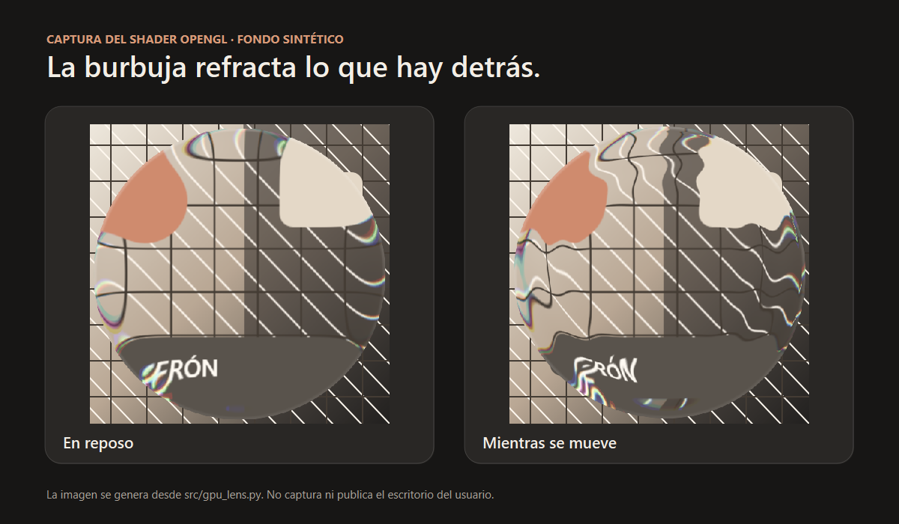
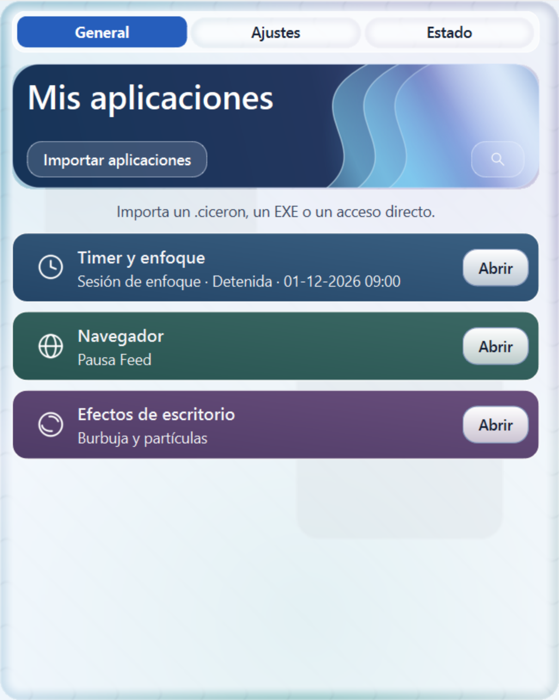
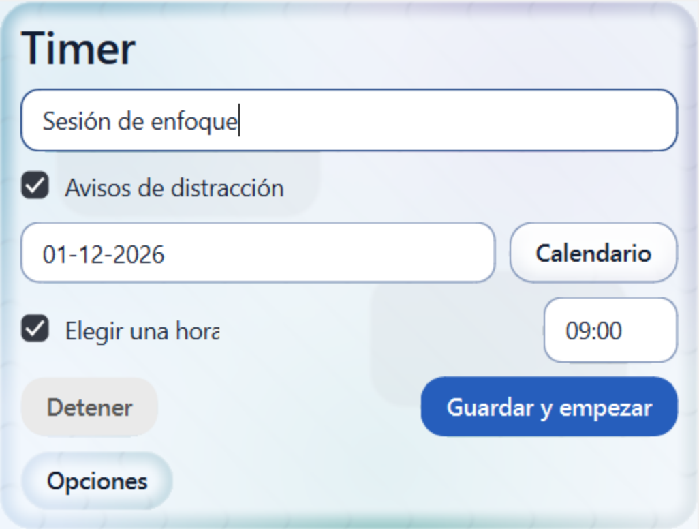
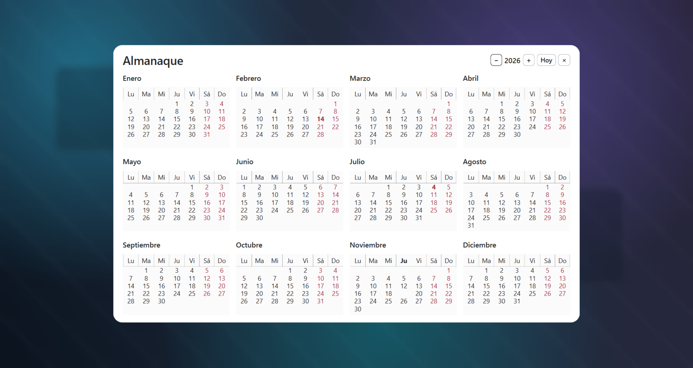

<div align="center">
  
  <h1>Cicerón</h1>
  <p><strong>Un pequeño centro de control para todo tu escritorio.</strong></p>
  <p>Accesos, miniapps, Timer y Liquid Glass, reunidos en una barra lateral para Windows.</p>
  <p>
    
    
    
    
  </p>
</div>

<p align="center">
  
</p>

<p align="center"><sub>Captura real del render OpenGL de Cicerón sobre un fondo de prueba. La escena sintética deja ver la refracción sin incluir contenido del escritorio personal.</sub></p>

## Una barra. Tus herramientas.

Cicerón mantiene accesibles tus aplicaciones y herramientas sin ocupar el escritorio cuando no las usas. Una pequeña burbuja en el borde abre la barra; desde allí puedes entrar al centro, abrir tus miniapps o usar el Timer.

<h3 align="center">Cicerón por dentro</h3>

<table>
  <tr>
    <td></td>
    <td></td>
  </tr>
  <tr>
    <td colspan="2" align="center"></td>
  </tr>
</table>

<p align="center"><sub>Las pantallas usan datos y fondos sintéticos de demostración.</sub></p>

| Herramienta | Para qué sirve |
| --- | --- |
| **Barra Liquid Glass** | Acceso lateral discreto que se despliega al acercarte. La burbuja refracta el fondo en tiempo real. |
| **Miniapps** | Instala paquetes `.ciceron` con punto de entrada `.exe` o Python; cada app conserva su identidad y sus datos. |
| **Timer** | Inicia sesiones de enfoque y administra sus avisos. |
| **Pausa Feed** | Controla la extensión del navegador desde Cicerón. |

## Empezar en Windows

1. Instala [Python 3.12](https://www.python.org/downloads/) y el lanzador `py`.
2. Descarga o clona este repositorio.
3. Ejecuta `Instalar.bat`. La primera instalación prepara el entorno y puede necesitar Internet para instalar dependencias.
4. Abre Cicerón con `Abrir Ciceron.bat` o desde el menú Inicio.

La carpeta `Aplicacion\datos\` guarda la configuración, los paquetes y los datos de las apps. Puedes mover la carpeta completa de la aplicación y reparar los accesos desde la nueva ubicación.

## Desarrollo

Para ejecutar desde el código con un perfil separado de la instalación diaria:

```bat
scripts\Ejecutar en desarrollo.bat
```

Las imágenes de demostración se pueden regenerar en Windows con el entorno del proyecto:

```powershell
$env:QT_QPA_PLATFORM = 'windows'
.venv\Scripts\python.exe assets\readme\generate_bubble_demo.py
.venv\Scripts\python.exe assets\readme\generate_ui_demo.py
```

El generador de la burbuja necesita una GPU compatible con OpenGL. El generador de la galería renderiza los widgets de Cicerón sobre fondos sintéticos y no captura el escritorio.

Las instrucciones para probar, actualizar, mover la instalación y añadir miniapps están en estas guías:

- [Instalar, actualizar, mover y recuperar](INSTALL.md)
- [Desarrollo y pruebas](DESARROLLO.md)
- [Formato de miniapps y traslado de datos](docs/paquetes-ciceron.md)
- [Guía de uso](LEEME.txt)
- [Integración del navegador](navegador/ESTADO.md)

## Proyecto

Cicerón está diseñado para ejecutarse desde una carpeta y mantener los datos de uso diario dentro de ella. El código del centro es Python; las miniapps pueden actualizarse por separado mediante su paquete. Consulta [AGENTS.md](AGENTS.md) antes de contribuir.
