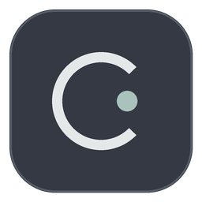

# Cicerón

Cicerón es un centro de control para aplicaciones personales de Windows. Su barra lateral reúne accesos, aplicaciones empaquetadas, un temporizador, efectos de escritorio y los controles de Pausa Feed del navegador.

## Ejecutar desde el código

1. Instala Python 3.12 en Windows.
2. Ejecuta `scripts\Ejecutar en desarrollo.bat` para abrir un perfil de prueba que puede convivir con la copia instalada.

## Instalar y actualizar

Ejecuta `Instalar.bat` desde la revisión elegida. Cicerón funciona con Python 3.12 y conserva tus datos en `Aplicacion\datos\`. Abre la versión instalada con `Abrir Ciceron.bat` o busca **Cicerón** en Inicio. [Instalar, actualizar, mover y recuperar](INSTALL.md)

- [Guía de uso](LEEME.txt)
- [Desarrollo y pruebas](DESARROLLO.md)
- [Crear un paquete para Cicerón](docs/paquetes-ciceron.md)
- [Integración del navegador](navegador/ESTADO.md)
